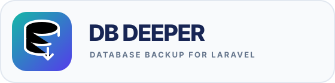

<p align="center">
    
</p>

<p align="center">
    Database backup and recovery for Laravel.
</p>

DB Deeper is an independent Laravel package in early development. It currently provides the package foundation and a protected dashboard at `/db-deeper`. Backup generation, uploads, retention, and restore are planned and are **not available yet**.

## Requirements

- PHP 8.3 or newer
- Laravel 11, 12, or 13

## Development setup

```bash
git clone https://github.com/integrad/laravel-db-deeper.git
cd laravel-db-deeper
composer install
composer test
```

Orchestra Testbench provides the Laravel application used during local development and tests.

## Install in a Laravel application

When a tagged release is available on Packagist, install it in a Laravel application:

```bash
composer require integrad/laravel-db-deeper
php artisan vendor:publish --tag=db-deeper-config
php artisan vendor:publish --tag=db-deeper-assets
```

The dashboard defaults to `/db-deeper`. Access is protected by Laravel's `auth` middleware and the `viewDbDeeper` Gate ability. Define that ability in the host application and allow only trusted operators:

```php
use Illuminate\Support\Facades\Gate;

Gate::define('viewDbDeeper', function ($user): bool {
    return $user->is_admin;
});
```

The route, middleware, and dashboard path can be changed in `config/db-deeper.php`. Set `dashboard.enabled` to `false` to disable the panel.

## Storage destinations

The planned upload workflow will use a filesystem disk from the host Laravel application, selected with `db-deeper.backup.disk`. Configure the disk in the host application's `config/filesystems.php`; storage credentials belong in the host application's environment or secret manager. Laravel disks can use S3-compatible storage (including Cloudflare R2), FTP, or SFTP.

Laravel's FTP and SFTP filesystem adapters are optional dependencies. Install the adapter required by the host application:

```bash
composer require league/flysystem-ftp:^3.0
# or
composer require league/flysystem-sftp-v3:^3.0
```

When uploads are implemented, set `db-deeper.backup.disk` to the configured disk name, such as `backup-ftp` or `backup-sftp`.

## Development status

- Package skeleton and Composer metadata
- Configurable, protected dashboard
- Database dump drivers: planned
- Streaming compression and authenticated encryption: planned
- S3-compatible, FTP, and SFTP uploads and integrity verification: planned
- Retention and restore workflow: planned
- Scheduled execution and failure notifications: planned

Backups contain sensitive production data. Before relying on this package for recovery, completed uploads must be verified and restores exercised against an isolated database.

## License

This project is licensed under the PolyForm Noncommercial License 1.0.0. Commercial use requires prior written authorization from Integrad at josue.gomes@integrad.com.br. Read the full [license terms](LICENSE.md). This is source-available software and is not an OSI-approved open source license.

Required Notice: Copyright Integrad. For commercial licensing, obtain prior written authorization at josue.gomes@integrad.com.br.

The license does not guarantee that a backup is complete or restorable. Read the operational [backup and recovery disclaimer](DISCLAIMER.md), and verify backups with integrity checks and restore drills before relying on them.
